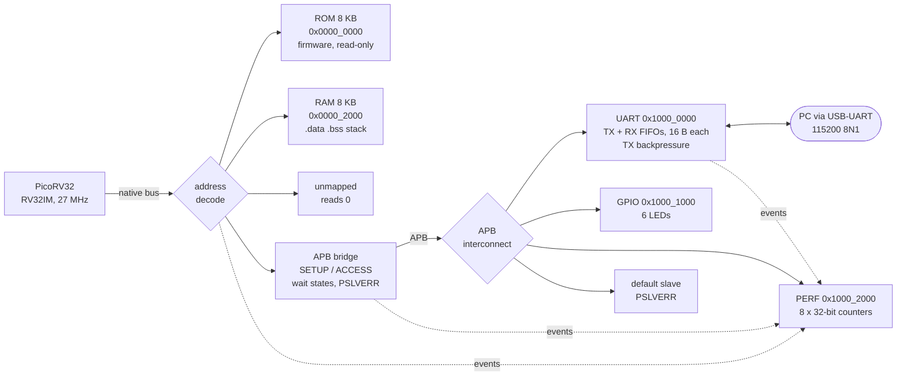

# RV32IM SoC on Tang Nano 20K

A small RISC-V system-on-chip on a Sipeed Tang Nano 20K FPGA (Gowin GW2AR-18): a PicoRV32
RV32IM core, ROM and RAM, an AMBA APB peripheral bus with a FIFO-buffered UART, and hardware
performance counters. Built entirely with open-source tools (Yosys, nextpnr-himbaechel, Apicula),
verified in Verilator, and run on the board with bare-metal C firmware.

## Results (measured on the board, 27 MHz clock, 115200 baud)

| | |
|---|---|
| Hardware self-tests run by the firmware | 11 of 11 pass |
| Verilator vs hardware | identical output and counter values, to the clock cycle |
| M extension (MUL/MULH/MULHSU/MULHU/DIV/DIVU/REM/REMU) | 2,752 results checked against a software reference, 0 wrong |
| UART TX backpressure | the write after a full FIFO is held 1,797 cycles = 1,784 stall cycles (counter) + 13 (same write, no stall) |
| Polling vs backpressure driver, 128 bytes | same time (260k cycles, line-rate bound); 12,700 vs 129 bus transfers |
| Reset behaviour | output after an S1 reset identical to the first run (`.data` restored from ROM) |
| Timing | SDC constraint met; Fmax 115.9 MHz (nextpnr post-route estimate) |
| Resources | 3,947 LUT4 (19%), 1,590 FF (10%), 8 of 46 BSRAM, 1 DSP |
| Lint | Verilator `-Wall` clean; one documented waiver |

Every self-test was checked for sensitivity by injecting a fault into the RTL or startup code and
confirming the test fails (7 faults, all caught, down to a counter that was off by one cycle).

## Architecture



- **CPU:** PicoRV32 (unmodified), RV32IM. Multiplies use one DSP block; divides are iterative.
  `rdcycle` / `rdinstret` enabled. 4.65 cycles per instruction on the self-test.
- **Memory:** 8 KB ROM holds the firmware image, preloaded at configuration and write-protected.
  8 KB RAM holds `.data`, `.bss` and the stack. One wait state each.
- **APB bridge:** converts each CPU access into an APB SETUP + ACCESS transfer, passes slave wait
  states (PREADY low) back to the CPU as stalls, and reports PSLVERR.
- **UART:** 16-byte TX and RX FIFOs. A write to a full TX FIFO is held on the bus instead of being
  dropped. RX overrun and framing errors set sticky, write-1-to-clear flags.
- **Performance counters:** eight 32-bit event counters with enable and clear (table below).
- **Board wrapper:** power-on reset, button S1 = reset, all six LEDs on if the CPU traps.

### Memory map

| Address | Register | Access |
|---|---|---|
| `0x0000_0000`–`0x0000_1FFF` | ROM 8 KB: code, constants, `.data` initial values; writes ignored | RX |
| `0x0000_2000`–`0x0000_3FFF` | RAM 8 KB: `.data`, `.bss`, stack | RW |
| `0x1000_0000` | UART DATA: W push TX byte (waits if FIFO full), R pop RX byte | RW |
| `0x1000_0004` | UART STATUS: 0 TX_FULL, 1 TX_IDLE, 2 RX_EMPTY, 3 RX_FULL, 4 RX_OVERRUN\*, 5 RX_FRAME_ERR\* (\*sticky, write 1 to clear) | RW |
| `0x1000_0008` | UART LEVELS: [4:0] TX level, [12:8] RX level | R |
| `0x1000_1000` | GPIO LED: bits 5:0, 1 = on | RW |
| `0x1000_2000` | PERF CTRL: bit0 ENABLE, write bit1 = clear all | RW |
| `0x1000_2004`–`0x1000_2020` | PERF counters (below) | R |
| other `0x1xxx_xxxx` | APB default slave: PSLVERR, reads 0 | |
| anything else | reads 0, writes ignored, counted as a bus error | |

### Performance counters

| Offset | Counter | Counts cycles / events where |
|---|---|---|
| `0x04` | CYCLES | every clock |
| `0x08` | MEM_WAIT | the CPU waits for any memory or peripheral access |
| `0x0C` | APB_WAIT | an APB slave holds PREADY low |
| `0x10` | APB_XFER | an APB transfer completes |
| `0x14` | BUS_ERR | an access ends in PSLVERR or at an unmapped address |
| `0x18` | TX_STALL | a UART DATA write is held because the TX FIFO is full |
| `0x1C` | TX_FULL | the TX FIFO is full (backpressure asserted) |
| `0x20` | RX_DROP | a received byte is dropped because the RX FIFO is full |

## Verification

1. **Self-checking firmware** (`fw/main.c`): every hardware feature is exercised from software and
   reports PASS or FAIL: `.data` restore, ROM write protection, bus errors, the M extension, each
   counter against an independent measurement, TX FIFO fill and backpressure, RX overrun.
2. **Verilator testbench that plays the PC** (`sim/tb_soc.cpp`): decodes the UART TX pin into text,
   drives bytes into the RX pin when the firmware prints a cue, then resets the CPU (like pressing
   S1) and runs again. Passes only if nothing failed and both runs print identical output.
3. **Fault injection:** each check was confirmed to fail on a deliberately broken design. Details
   in [docs/DEVLOG.md](docs/DEVLOG.md).
4. **Board test** (`host/board_test.py`): the same script over the real USB serial port. The board's
   output matches simulation exactly.
5. **Lint:** Verilator `-Wall` on all project RTL (third-party core excluded), zero warnings.
6. **Timing:** `constraints/soc.sdc` constrains the 27 MHz clock; a violation stops the build
   (checked by constraining 200 MHz, which fails with `ERROR`).

## Build and run

Requirements: [OSS CAD Suite](https://github.com/YosysHQ/oss-cad-suite-build) (Yosys, nextpnr,
Apicula, openFPGALoader, Verilator), a RISC-V GCC such as
[xPack riscv-none-elf-gcc](https://github.com/xpack-dev-tools/riscv-none-elf-gcc-xpack), `make`,
Python 3 with `pyserial`. On macOS, `install_riscv_gcc.sh` installs the compiler.

```bash
source <path>/oss-cad-suite/environment

make sim         # firmware + Verilator: two runs with a reset between, ends with "result: PASS"
make lint        # "lint: clean"
make bit         # bitstream build/soc.fs; timing checked against constraints/soc.sdc
make boardtest   # program the board and run the checks over USB serial; press S1 when asked
make term        # interactive terminal: test output, then an echo prompt
```

On the board: all six LEDs lit and not changing means the CPU trapped; LEDs `101010` after the
tests means a check failed. The board's USB-serial chip drops bursts above roughly 64 bytes, so host
scripts send at most 32 bytes at a time.

## Design decisions

- **APB for peripherals, native bus for memory.** Memory stays at one wait state; peripherals get a
  standard, simple protocol with wait states and errors. The bridge costs two cycles per access.
- **Backpressure instead of dropping bytes.** A full TX FIFO stalls the write rather than losing data,
  so a driver can write without polling. The counters show the trade-off: no wasted bus transfers,
  but the CPU stalls for the whole transmission.
- **ROM/RAM split.** The firmware image is write-protected, and `start.S` copies `.data` from ROM
  to RAM on every reset. Without it, a reset kept modified globals (found on day 1, see the log).
- **Never hang the CPU.** Unmapped addresses answer immediately (PSLVERR or zero) and are counted.
- **Synchronous resets everywhere** except the two power-on-reset registers, which have no reset
  to use; that is the single lint waiver.
- **SDC on the internal clock net.** nextpnr's analysis uses the buffered net `u_soc.clk`; a
  constraint on the input port was accepted but not applied (analysis fell back to 12 MHz).

## Limitations and next steps

- **Interrupts.** Both UART drivers keep the CPU busy for the whole transmission. A TX-empty / RX
  interrupt (PicoRV32 supports IRQs) would free it; the counters would show the difference.
- **Faster clock.** Timing closes at about 116 MHz, the board runs at 27 MHz. The on-chip PLL could
  raise it; the critical path (block-RAM read data into the CPU's load alignment logic, 8.6 ns)
  would be the next limit.
- **Instruction prefetch or a small cache** to cut the memory wait cycles (MEM_WAIT).
- **Formal checks** of the APB protocol (for example with SymbiYosys) and CI running `make sim lint bit`.

## Repository layout

```
rtl/soc_top.v            CPU, ROM, RAM, address decode, APB bus, counters
rtl/board_top.v          pins, power-on reset, S1 = reset, trap indicator
rtl/apb_bridge.v         CPU native bus -> APB master
rtl/apb_interconnect.v   APB address decode + read mux, default error slave
rtl/apb_uart.v           UART registers, FIFOs, backpressure, error flags
rtl/apb_gpio.v           LED register
rtl/apb_perf.v           performance counters
rtl/fifo.v               synchronous first-word-fall-through FIFO
rtl/uart_tx.v, uart_rx.v 8N1 transmitter and receiver
rtl/ram.v                32-bit memory with byte enables, optional preload
rtl/third_party/         PicoRV32, unmodified (ISC license)
fw/start.S, fw/link.ld   reset entry and memory layout
fw/soc.h                 register map, counter helpers
fw/uart.c, fw/mtest.c    UART driver, M-extension self-test
fw/main.c                hardware self-tests, driver profile, echo prompt
sim/tb_soc.cpp           Verilator testbench that plays the PC
sim/lint.vlt             lint configuration
host/board_test.py       board test over USB serial
constraints/             pins (tangnano20k.cst), timing (soc.sdc)
tools/bin2hex.py         firmware image to $readmemh format
docs/DEVLOG.md           stage-by-stage results, problems found, fault injection
```

## License

MIT for this project's code ([LICENSE](LICENSE)). PicoRV32 keeps its ISC license
([rtl/third_party/PICORV32_LICENSE](rtl/third_party/PICORV32_LICENSE)).

## Credits

[PicoRV32](https://github.com/YosysHQ/picorv32) by Claire Xenia Wolf and contributors (ISC license).
Pin assignments follow Sipeed's [Tang Nano 20K examples](https://github.com/sipeed/TangNano-20K-example)
and the [Apicula](https://github.com/YosysHQ/apicula) board files.
